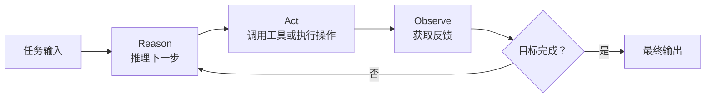
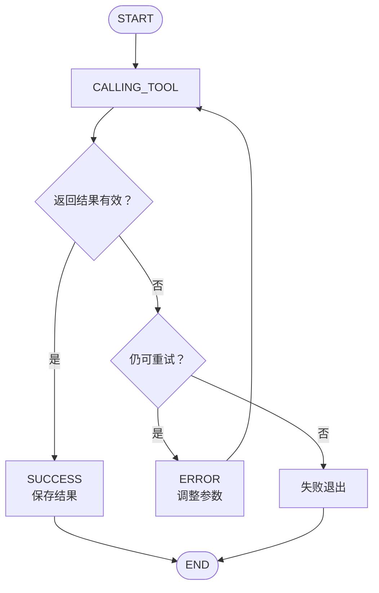
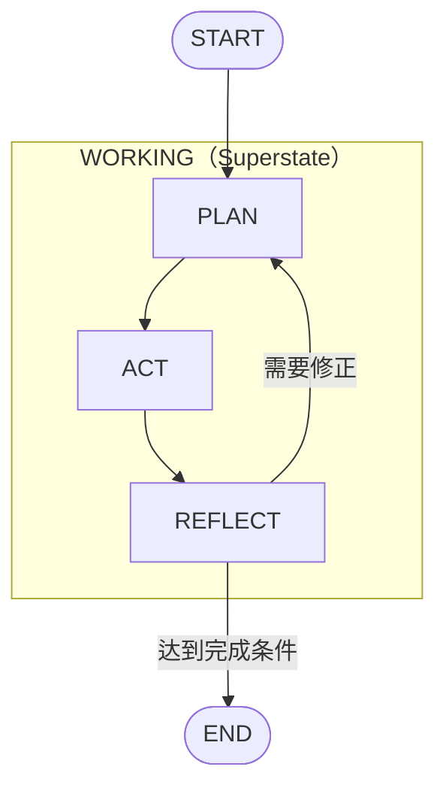
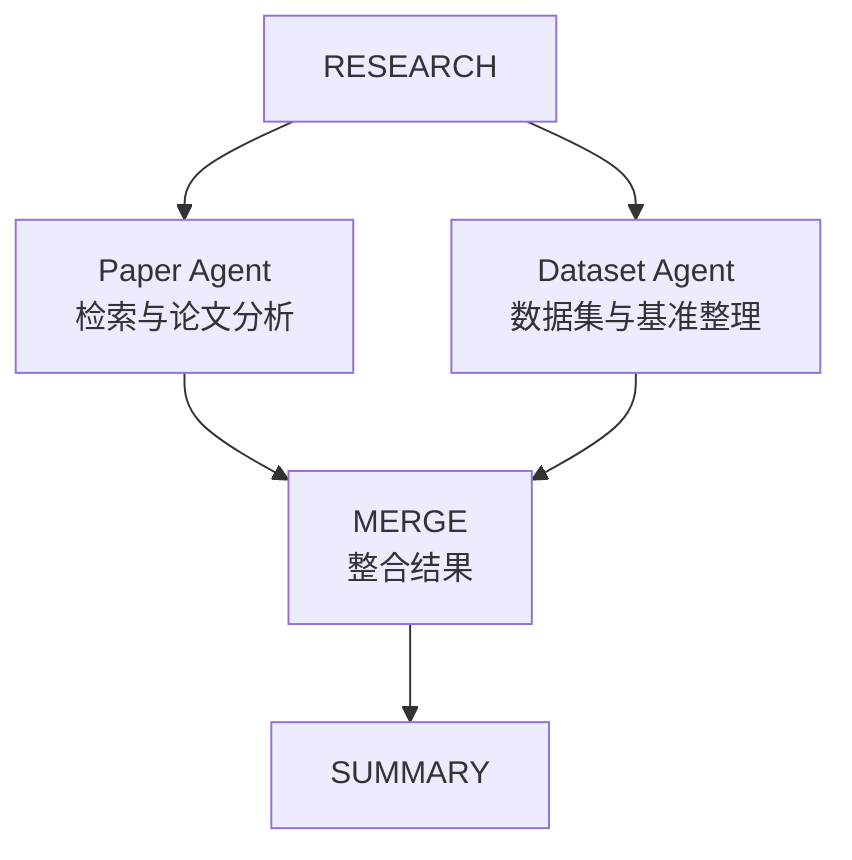

# Chapter 1｜From LLMs to Agents: The Foundational Blueprint

> **本章一句话总结：**AI Agent 不是“更会回答问题的 LLM”，而是把 LLM 放进由 **状态（State）、控制流（Control Flow）、工具（Tools）、反馈（Feedback）和记忆（Memory）** 组成的系统中，使其能够持续决策、执行、观察结果并调整下一步行动。
>
> **最重要的工程观念：**LLM 提供智能判断，外部工作流负责执行、约束、恢复和终止。FSM/HSM 是理解这一控制结构的基础。

**教材：**Nicole Koenigstein，*AI Agents: The Definitive Guide*，第 1 章（PDF 第 22–55 页）。
**配套代码：**[官方 GitHub 仓库](https://github.com/Nicolepcx/ai-agents-the-definitive-guide)；[个人学习仓库](https://github.com/miracle-huang/Learn-Agentic-AI-LLM/tree/main/ai-agents-the-definitive-guide)。

<!-- notion-toc:start -->

- [Chapter 1｜From LLMs to Agents: The Foundational Blueprint](#chapter-1from-llms-to-agents-the-foundational-blueprint)
  - [一、本章核心观点](#一本章核心观点)
    - [1. 从静态 LLM 到动态 Agent](#1-从静态-llm-到动态-agent)
    - [2. Agent 的六个主要组成部分](#2-agent-的六个主要组成部分)
    - [3. Stateless 与 Stateful 的区别](#3-stateless-与-stateful-的区别)
  - [二、有限状态机（Finite State Machine, FSM）](#二有限状态机finite-state-machine-fsm)
    - [1. FSM 是什么？](#1-fsm-是什么)
    - [2. FSM 的五个核心概念](#2-fsm-的五个核心概念)
    - [3. FSM 的工具调用示例](#3-fsm-的工具调用示例)
  - [三、分层状态机（Hierarchical State Machine, HSM）](#三分层状态机hierarchical-state-machine-hsm)
    - [1. HSM 是什么？它与 FSM 有什么区别？](#1-hsm-是什么它与-fsm-有什么区别)
    - [2. HSM 的四个关键概念](#2-hsm-的四个关键概念)
    - [3. Superstate：让所有子流程遵守同一套规则](#3-superstate让所有子流程遵守同一套规则)
    - [4. History：Shallow 与 Deep 的区别](#4-historyshallow-与-deep-的区别)
    - [5. Parallel Region：并行工作流与 MAS](#5-parallel-region并行工作流与-mas)
  - [四、FSM / HSM 如何映射到 LangGraph？](#四fsm--hsm-如何映射到-langgraph)
    - [1. 最小的 Tool-Calling Agent 图](#1-最小的-tool-calling-agent-图)
    - [2. 什么时候用 FSM，什么时候考虑 HSM？](#2-什么时候用-fsm什么时候考虑-hsm)
  - [五、Agent 的自主性光谱（Autonomy Spectrum）](#五agent-的自主性光谱autonomy-spectrum)
  - [六、本章的最终结论与实践任务](#六本章的最终结论与实践任务)
    - [P0 动手复现清单](#p0-动手复现清单)
    - [复习时需要特别注意](#复习时需要特别注意)

<!-- notion-toc:end -->

---

## 一、本章核心观点

### 1. 从静态 LLM 到动态 Agent

传统的单次 LLM 调用是“输入 Prompt → 模型生成 → 返回文本”，缺少与外部环境持续互动的机制。
Agent 则使用迭代闭环：



- **Reasoning（推理）：**理解目标、拆解问题、确定下一步操作。
- **Acting（行动）：**搜索、执行代码、访问 API、使用专用工具。
- **Observing（观察）：**读取工具返回值、错误、测试结果或环境变化。
- **Feedback / Updating（反馈与更新）：**根据观察更新状态，改变计划或尝试其他方案。

**例子：**用户要求“查询纽约当前气温，再计算其摄氏度数值的平方”。Agent 先搜索，再从结果提取数值，然后调用计算器，并根据两次工具结果生成最终答案。关键不是一次回答，而是能够根据实际观察继续执行。

### 2. Agent 的六个主要组成部分

| 组成部分 | 主要职责 |
| --- | --- |
| LLM | 理解任务、推理、选择后续动作 |
| Planning | 任务分解、计划与策略调整 |
| Tools | 搜索、计算、代码执行、外部 API 等 |
| State | 当前工作流的运行快照与控制数据 |
| Memory | 保存和复用历史信息（短期或长期） |
| Control Flow | 定义节点、执行顺序、分支、循环、停止条件 |

**State ≠ Memory，也不只是 Prompt 上下文。**

- **State（运行状态）**包含消息列表、工具结果、当前进度、路由标记、检查点或分支信息等；它描述整个工作流“现在是什么情况”。
- **Memory（记忆）**侧重信息持久化和跨步骤/跨会话复用。记忆可能存放在状态里，也可能由外部存储管理。
- **Prompt Context（上下文）**是传给模型的一部分信息，并不等于工作流的全部状态。

### 3. Stateless 与 Stateful 的区别

| 维度 | 无状态调用 | 有状态 Agent 工作流 |
| --- | --- | --- |
| 执行 | 独立的一次调用或一次工具循环 | 多轮执行，持续更新状态 |
| 历史 | 下一次调用需要重新提供 | 可从已有状态/检查点恢复 |
| 工具 | 可以使用，但结果可能只在本次有效 | 工具结果可进入共享状态 |
| 控制 | 简单的临时循环逻辑 | 显式节点、路由、分支、终止条件 |
| 恢复 | 往往需要重新执行 | 可在适当节点或检查点续跑 |

**容易误解的地方：**“能调用工具”不等于“已经有跨会话状态”。书中先演示 Stateless Tool Loop，再使用 LangGraph 的 State 和 Checkpointer 实现跨轮次延续。

---

## 二、有限状态机（Finite State Machine, FSM）

### 1. FSM 是什么？

**FSM 是一种用有限个控制状态和明确的状态转换规则描述程序行为的模型。**
例如，Agent 可以处于 `PLAN`、`ACT`、`OBSERVE` 或 `END`。接收到事件后，根据当前状态和转换条件决定下一步去哪里。
用形式化的方式概括：`next_state = transition(current_state, event)`。工程实现通常还会引入 Guard（条件）和 Action（状态转换时的操作）。
“有限”指**控制模式的数量有限**，不是说消息、工具返回内容或任务数据必须有限。一个只有三个节点的 LangGraph，仍然能够处理不断增长的消息记录。

### 2. FSM 的五个核心概念

| 概念 | 定义 | Agent 示例 |
| --- | --- | --- |
| State（状态） | 系统当前所处的执行模式/状态快照 | 正在调用工具、正在验证结果 |
| Event（事件） | 自上次决策以来发生的事情 | 搜索工具返回结果、超时 |
| Guard（守卫条件） | 判断某种转换是否被允许 | 结果有效吗？重试次数是否超限？ |
| Action（动作） | 转换时执行的操作 | 调用工具、追加消息、保存检查点 |
| Termination（终止） | 决定何时停止运行 | 完成任务或达到失败上限 |

**State 与 Event 的区别：**State 说的是“现在处于什么模式”；Event 说的是“发生了什么”。同一个工具返回事件可能根据 Guard 的判断导向成功、重试或失败。

### 3. FSM 的工具调用示例



例如“自动生成研究报告”可以设计为：
`PLANNING → SEARCHING → ANALYZING → WRITING → VALIDATING → FINISHED`
但是**任务清单本身还不是完整的 FSM**：必须同时规定转换规则。

- 如果分析时发现资料不够，`ANALYZING → SEARCHING`。
- 如果写好的报告验证失败，`VALIDATING → WRITING`（也可能回到搜索）。
- 如果验证成功，`VALIDATING → FINISHED`。
- 如果工具异常且超过重试上限，进入 `ERROR` 并结束。

**FSM 的价值：**执行步骤明确、路由可审计、容易定位错误，也便于在状态边界保存和恢复进度。
**FSM 的局限：**当规划、反思、审批、重试、异常恢复等越来越多时，平铺的状态和边会高度重复，甚至形成难以维护的“意大利面式路由”。

---

## 三、分层状态机（Hierarchical State Machine, HSM）

### 1. HSM 是什么？它与 FSM 有什么区别？

**HSM 允许一个状态内部继续包含其他状态，即“状态中的状态”。**
普通 FSM 将 PLAN、ACT、REFLECT 平铺为同一级状态；HSM 可以将它们统一封装到 `WORKING` 父状态内。



**核心区别：**FSM 管理“状态之间如何转移”，HSM 进一步管理“相关状态如何组合、共享规则以及恢复执行位置”。

### 2. HSM 的四个关键概念

| 概念 | 作用 | 对应 Agent 设计 |
| --- | --- | --- |
| Superstate（父状态） | 聚合子状态，共享进入/退出逻辑与共同约束 | WORKING、RESEARCH |
| Substate（子状态） | 在父状态内部承担具体任务 | PLAN、ACT、REFLECT |
| History（历史标记） | 记住离开父状态时的活动位置 | 暂停后从原执行阶段恢复 |
| Parallel Region（并行区域） | 允许多个子区域各自推进 | 并行调用工具、多个专用 Agent 分工 |

### 3. Superstate：让所有子流程遵守同一套规则

假设一个 `WORKING` 父状态包含三个子状态：

```plain text
WORKING
├── 共享策略
│   ├── 工具调用次数上限
│   ├── 成本预算检查
│   ├── 权限与安全检查
│   └── 失败熔断规则
├── PLAN
├── ACT
└── REFLECT
```

与在 PLAN、ACT、REFLECT 各写一遍预算检查相比，把共有约束放到父级更容易维护。原书特别举例：可以把 rate limit、安全过滤器和 circuit breaker 关联到 `WORKING`。
**工程注意：**将 Subgraph 作为 Superstate 是一种架构映射；在 LangGraph 中，父级 Guard 是否对每次内部工具调用都生效，需要你明确设计和实现，不能仅凭“有父图”就认为检查会自动发生。

### 4. History：Shallow 与 Deep 的区别

假设在 `WORKING → RESEARCH → EXTRACT` 处暂停：

```plain text
WORKING
└── RESEARCH
    ├── SEARCH
    ├── EXTRACT  ← 暂停前所处位置
    └── SUMMARIZE
```

- **Shallow History（浅历史）：**记住最近激活的直接子状态，例如 `RESEARCH`。
- **Deep History（深历史）：**进一步记住更内层的活动状态，例如 `EXTRACT`。

这让 Agent 有机会避免重复执行搜索、提取和计算任务。
**History ≠ Checkpointer：**History 是状态机中“应该返回哪个状态”的语义；Checkpointer 是保存实际运行快照的机制。两者结合才能实现可靠恢复。书中使用 LangGraph 的 `MemorySaver` 作为示例；它是内存存储，不能直接等同于生产环境中的持久化数据库。

### 5. Parallel Region：并行工作流与 MAS

在 `RESEARCH` 父状态下，可以把论文检索与数据集分析分给不同 Agent，再将结果合并。



这种层级结构可以帮助组织 Multi-Agent System（MAS），但 **HSM 不等于 MAS**：一个单 Agent 也可以使用 HSM，一个 MAS 也可以有其他控制结构。

---

## 四、FSM / HSM 如何映射到 LangGraph？

| 状态机概念 | LangGraph 对应实现 |
| --- | --- |
| 运行状态 / 数据 | `State`，常用 `TypedDict` 定义 |
| 执行步骤 | `Node`（普通 Python 函数、LLM 或工具节点） |
| 状态转换 | `Edge` |
| Guard / 路由 | `add_conditional_edges()`  • Router |
| 父状态 / 子状态 | `Subgraph`  • 内部节点 |
| 恢复 / 历史 | Checkpointer、Thread ID、必要时显式保存历史标记 |
| 终止 | `END` |

### 1. 最小的 Tool-Calling Agent 图

以下是依据书中 Example 1-5 和 1-6 整理的核心结构。假设 `llm` 已经绑定工具，`tools` 已预先定义：

```python
from typing import Annotated, TypedDict
from langchain_core.messages import BaseMessage
from langgraph.graph import StateGraph, START, END
from langgraph.graph.message import add_messages
from langgraph.prebuilt import ToolNode
from langgraph.checkpoint.memory import MemorySaver

class AgentState(TypedDict):
    messages: Annotated[list[BaseMessage], add_messages]

def llm_node(state: AgentState):
    response = llm.invoke(state["messages"])
    return {"messages": [response]}

def route(state: AgentState):
    last = state["messages"][-1]
    return "tools" if getattr(last, "tool_calls", None) else END

builder = StateGraph(AgentState)
builder.add_node("llm", llm_node)
builder.add_node("tools", ToolNode(tools))
builder.add_edge(START, "llm")
builder.add_conditional_edges("llm", route, {"tools": "tools", END: END})
builder.add_edge("tools", "llm")

app = builder.compile(checkpointer=MemorySaver())
config = {"configurable": {"thread_id": "session-1"}}
```

**代码背后的状态机：**

- `llm` 节点决定继续调用工具还是给出最终答案。
- `route()` 根据最后一条消息是否包含 `tool_calls` 决定下一节点。
- `tools` 节点执行模型所请求的工具，并把结果放回消息状态。
- `tools → llm` 形成“推理—行动—观察”循环。
- Checkpointer 与 `thread_id` 使同一会话的执行记录可以被再次读取。

**关键认识：**LLM 发出工具调用请求，不代表 LLM 本身执行了 Python 函数。工具执行、权限校验、分支控制和停止规则是外部 Agent Runtime/程序的职责。

### 2. 什么时候用 FSM，什么时候考虑 HSM？

| 任务特征 | 建议 |
| --- | --- |
| 简单的工具循环、少量明确节点 | 优先用平铺 FSM / LangGraph 基本图 |
| 多个步骤共享预算、安全、超时策略 | 考虑 HSM 思想与父子图 |
| 子任务内部又包含多步推理与工具调用 | 使用 Subgraph 封装 |
| 需要中断、审批、续跑 | 设计 Checkpoint 与恢复语义 |
| 多个专用 Agent 独立运行后汇总 | 并行分支 / 分层编排，并明确 Join 条件 |

---

## 五、Agent 的自主性光谱（Autonomy Spectrum）

作者将不同 Agent 系统理解为逐渐扩大的“可选择行为范围”：
`Router → Tool-Calling Agent → Multi-Agent System → 理想化的完全自主系统`

- **Router：**做一次简单决策，从预设路径中选择一条。
- **Tool-Calling Agent：**可以多步调用工具、反思、更新计划和利用记忆。
- **MAS：**多个专用 Agent 在 Supervisor 或共享协议下协作，可包含并行流程。
- **Fully Autonomous Agent：**理论上能自行重新设计控制图、创造并验证新工具，远超普通编排式系统的能力边界。

第一章的核心表述是 **Orchestrated Autonomy（编排式自主性）**：实际的 Agent 往往能在开发者提供的状态、边、工具和安全规则中自主选择，但不能任意改变系统架构。
作者以 **AI Scientist v2** 为例说明：多 Agent 工作流可以把研究推进到假设提出、实验、代码执行和论文草稿，但产出仍有引用、方法和深度等质量风险，需要人类监督。
> **自主性不是越大越好。** 工程上有约束、可追踪、可审计、可中断的 Agent 通常更容易安全部署。

---

## 六、本章的最终结论与实践任务

> **FSM 回答：**Agent 现在在哪一步？下一步允许走哪里？何时重试、失败或结束？
>
> **HSM 回答：**如何把复杂步骤组织成父子结构？如何复用规则、恢复子任务、管理并行工作？
>
> **LangGraph 回答：**如何把这些思想落实为可执行的 State、Node、Edge、Subgraph 和 Checkpoint？

### P0 动手复现清单

- [ ] 能解释 LLM、Agent、工具调用、State 和 Memory 的区别。
- [ ] 复现书中 Example 1-2～1-4：定义工具、绑定 LLM、执行 Stateless Tool Loop。
- [ ] 复现 Example 1-5～1-6：实现 LangGraph State、LLM Node、Tool Node、Router 和 Checkpointer。
- [ ] 复现 Example 1-7～1-13：检查执行 Trace、状态快照、同一 Thread 的延续与不同 Thread 的隔离。
- [ ] 在 Tool Loop 中加入最大步骤数、工具异常与失败重试控制。
- [ ] 把一个复杂子任务拆成 Subgraph，并明确父级预算或安全约束。
- [ ] 画出自己 Agent 的 FSM 图，标明 State、Event、Guard、Action、Termination。

### 复习时需要特别注意

1. **不要把 FSM 当成只有线性步骤的待办清单**；转换条件、循环与终止同样重要。
2. **不要把 State 等同于聊天记录**；运行控制和检查点也是状态管理的一部分。
3. **不要把 HSM 等同于 Multi-Agent**；分层状态可以存在于一个 Agent 内部。
4. **不要把 Checkpointer 等同于长期记忆**；它解决执行快照和恢复，长期知识管理还需要额外设计。
5. **不要把“模型提出行动”当成“模型已经执行行动”**；外部程序决定允许什么、如何执行及何时停止。

**第一章的主旨：Agent 的能力来自模型与系统架构的组合，而可控状态转换与有边界的自主性是可靠 Agent 工程的基础。**
